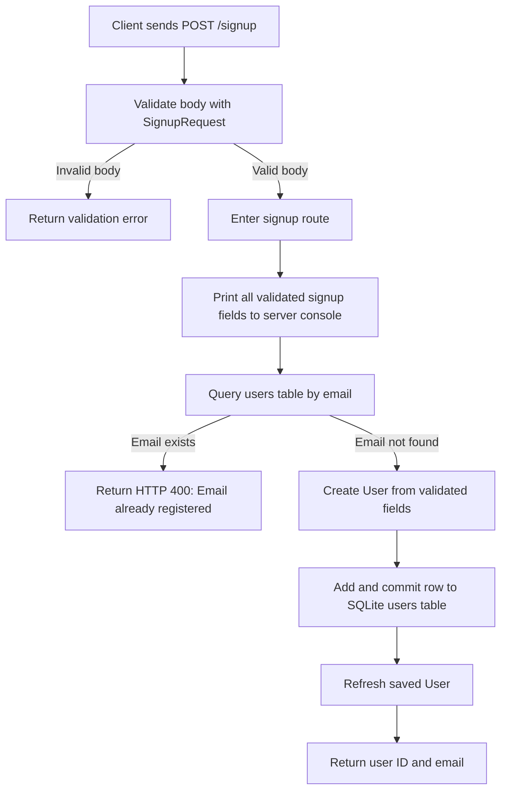

# SecurityGuys: Database and Data Flow

This guide explains what happens to a user's information when they sign up for SecurityGuys. It follows the data from the signup request to the database, shows which details are stored, and points out where information also appears in the server logs. The app currently uses one users table in a SQLite database.

## Signup data flow

The main path is client → request validation → signup route → database → response. The console receives a second copy of the validated signup fields before the duplicate-email check, including when an existing email causes the request to be rejected.

### Steps and code ownership

| Step | Source file | Current behavior |
| --- | --- | --- |
| Application startup | `backend/main.py` | Creates missing tables using `Base.metadata.create_all()` and registers the signup router. |
| Request validation | `backend/schemas.py` | Requires eight signup fields. Seven are strings; date of birth is parsed as a date. |
| Console output | `backend/routes/auth.py` | Prints the validated request object, including password, SSN, and medical history. |
| Duplicate check | `backend/routes/auth.py` | Looks for an existing user with the submitted email and returns HTTP 400 if found. |
| Database write | `backend/routes/auth.py` | Builds a `User` from the validated fields, commits it, and refreshes the saved object. |
| Persistent storage | `backend/models.py` | Defines the `users` table and its columns. |
| Database connection | `backend/database.py` | Opens a database session for the request and closes it afterward. |
| Successful response | `backend/routes/auth.py` | Returns only `id` and `email`. |

## Stored fields

All eight submitted fields are required by `SignupRequest`; `id` is generated when the user is saved. The sensitivity labels below are practical engineering categories, not legal classifications. Uses are described only where the current code demonstrates them.

| Field | Database declaration | Current use | Sensitivity | Printed during signup? | Returned on success? |
| --- | --- | --- | --- | --- | --- |
| `id` | Integer primary key | Identifies the saved user | Internal identifier linked to a person | No | Yes |
| `full_name` | `String(100)` | Stored profile information | Personal information | Yes | No |
| `email` | `String(255)`, unique | Duplicate lookup and response | Personal/contact information | Yes | Yes |
| `password` | `String(255)` | Stored directly; no login route is included | Authentication secret | Yes | No |
| `ssn` | `String(11)` | Stored; no further use is shown | Sensitive identity information | Yes | No |
| `date_of_birth` | `Date` | Stored; no further use is shown | Personal information | Yes | No |
| `address` | `String(255)` | Stored; no further use is shown | Personal/contact information | Yes | No |
| `phone` | `String(20)` | Stored; no further use is shown | Personal/contact information | Yes | No |
| `medical_history` | `Text` | Stored; no further use is shown | Sensitive health information | Yes | No |

The declared string lengths describe the model, but the request schema does not specify matching length limits or email, phone, or SSN format rules. Do not treat the length declarations as proof that SQLite enforces those limits.

## Storage and data lifecycle

- **Database location:** `sqlite:///./app.db`, relative to the server's working directory. Following the README's instruction to start from `backend` places the database at `backend/app.db`.
- **Database structure:** One `users` table with a primary key and a unique email column. No relationships or foreign keys are defined in this snapshot.
- **Additional copy:** Validated signup data is printed to standard output. Whether that output is saved elsewhere and how long it is retained depends on how the server is run; the repository does not configure this.
- **Protection in the write path:** The signup route performs no password hashing or field encryption before saving the values. The repository does not establish deployment-level protections.
- **Updates and deletion:** No profile update, account deletion, data export, or retention cleanup route/job is included.
- **Schema changes:** Startup creates missing tables. There is no migration setup for updating existing table structures.
- **Other endpoint:** `GET /health` returns a fixed status response and does not query the database.
